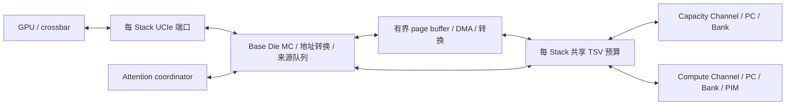

# H0 硬件合同：论文、参数、源码与验收

日期：2026-11-05。依据为本地固定 arXiv:2605.05639v2（2026-08-12），SHA256 见 `references/tokenstack_source_20261105.json`。本轮复核图 3、表 2 和相关章节；未检查更新版本。参数唯一台账为 `hardware_parameters.yaml`，未决项见 `open_questions.md`。

**更新状态：H0 论文规格仍未冻结；H1-H5 已实现具名工程候选，H6 工程验收/发布入口见 `../HARDWARE.md`。** 几何候选现在通过显式的工程 refresh 参数路径运行，Fabric 增加配置的 PIM result-ready 事件。下表及源码缺口分析保留为 H0 时点的审计快照，最新实现和精度以 HARDWARE.md、运行配置和最终验收 JSON 为准；不能将工程通过改写成论文参数歧义已解决。

## 证据与实现边界

`paper_arch` 是论文架构机制；`paper_eval` 是具体实验平台；`attacc_inherited` 是继承的实现；`engineering_assumption` 是本地选择；`derived` 必须保留公式。论文明确某个数字，不等于相邻微架构已明确。源码路径以下相对 `/home/ubuntu22/gem5/attacc_simulator/ramulator2/`。

| 模块/机制 | 论文证据 | 当前源码与配置 | 已有验证 / 尚需验收 |
| --- | --- | --- | --- |
| 垂直 Capacity/Compute/Base Die | §4.1、图 3，PDF p4-5 | `src/memory_system/impl/tokenstack_memory.cpp`，仅两个独立时序树 | `tests/test_layered.py::test_real_layer_state_isolation`；H1 扩展显式 4+4 Layer，不能把 domain 直接称为 die |
| 容量与 Bank | 图 3：2/1 GiB、16/8 Bank/PC；正文 per-bank 减半 | `src/dram/impl/HBM3-PIM.cpp::org_presets`，两树均使用 2-rank 同构 preset | H0-geometry/capacity/units；H1 必须验证完整几何、首尾地址、无别名和 refresh |
| 地址转换和布局 | §4.2、§5.1-5.2、图 4 | `src/addr_mapper/impl/hbm3_pim_linear_mappers.cpp` 仅 DRAM 位切片；前端两个全局窗口 | 已有路由/越界负例；H1 新建 die/page/head/K/V 映射与 K token-major、V feature-interleaved 校验 |
| 普通 RD/WR | §7 基于 Ramulator2 | `HBM3-PIM.cpp` 和 `hbm3_pim_controller.cpp` | 原始命令与回调的 21/29-cycle 核对；已有迁移与分层时延测试 |
| PIM 命令与协调 | §4.1-4.2，图 3(d) | MAC/WRGB/MV/SFM/SETM/SETH 有命令模型；没有数值运算或独立结果完成事件 | H0-completion；H4 需单元占用、broadcast/gather、结果尾延迟和依赖验证 |
| MC 和共享资源 | §4.2、4.3、6.4 | job 准入队列、整事务不可抢占、两域命令门控、64-cycle guard | 已有 grant/log 守恒；H2 需 GPU/PIM/DMA 来源队列、资源日历、公平性与 refresh 活性 |
| 层间 DMA | §4.2/5.2 page-at-a-time；§4.3 两 hop | `src/frontend/impl/memory_trace/tokenstack_trace.cpp` 的 RD→额外 hop→额外 hop→WR | 已有请求/物理字节/完成时间守恒；H3 需逐页 streaming、大块小 Buffer、背压和并发依赖 |
| K8V4、scatter/transpose | §5.2、6.2、7 | 仅 3/8 比率和吞吐匹配假设；无元素转换 | H0-k8v4 仅验证比例；H3 必须分别记 K/V、元数据、padding 和布局索引 |
| 外部 UCIe/跨栈 | §4.2-4.3、表 2 | 未实现独立端口、GPU crossbar 路由 | H5 需 2/5 Stack、端口预算与跨栈路径；不能添加隐式 Stack 直连 |

表中的旧测试是已存在的验证入口，其历史结果见 `results/layered-domains-v3/`；本轮实际重跑项见 H0 结果目录。未实现项列的是后续验收合同。

## 容量和地址合同

模型几何轴序固定为 `CH, PC, rank, BG, bank, row, column`。当前 mapper 的 column 已按 burst 粒度计数，不能再减一次 prefetch 位数。

```
burst_bytes = prefetch * dq_bits / 8
domain_bytes = product(CH,PC,rank,BG,bank,row,column) * burst_bytes
banks_per_PC_across_ranks = rank * BG * bank
```

当前 `HBM3_8Gb_2R` 的单 Channel 几何为 `[1,2,2,4,4,16384,32]`，burst=32 B，单 domain 的可解码空间为 **1 GiB**；16 Channel AttAcc preset 为 **16 GiB**。源码 density 检查使用 `PC*rank*BG*bank*row*column*dq*prefetch >> 20`，数值为 8192，尽管异常文本写 `Mb`，该计算按二进制 Mib；不是一个物理 die 的密度。源码注释说明 2R 对应 8-high stack。当前每个 domain 的每 PC 合计 32 Bank（每 rank 16），不能称为论文 Capacity 16 / Compute 8 Bank/PC。

两个 1 MiB region 是前端可访问窗口，不是 die 容量；1 GiB 的 Compute 全局基址也不是容量。位切片 mapper 自身丢弃高位，调用方必须做上界检查。H1 应支持稀疏地址，不申请整个容量的宿主机数组。

**有界候选 `fig3_binary_geometry_assumption_v1`：** 使用图示的 16/8 Bank/PC 与 2/1 GiB；假定每 die 16 Channel、每 Channel 2 PC、每 PC 4 BG、1 个逻辑 rank。Capacity 每 BG 4 Bank，Compute 每 BG 2 Bank，双方都用 4096 rows、32 burst-columns、32 B/burst。因此只通过 Bank 数减半获得容量减半，不再对 rows 做第二次减半。rows 是容量公式的推导值，不是已公开的论文 DRAM 行数。

单栈 4+4 为 Capacity 8 GiB + Compute 4 GiB；五栈为 40 GiB +20 GiB。按十进制分别为 42.94967296 GB、21.47483648 GB，与表 2 的 40/20 GB 标签不能直接相等。另保留十进制备选，不给它编造位切片几何。

候选每 Channel 的密度为 Capacity 1024 Mib、Compute 512 Mib。当前 `set_timing_vals` 的 density switch 仅列 2048..32768；缺失返回 -1，随后用于 `tRFC_TABLE[0][density_id]`。**H1 必须先增加有边界检查的 refresh 参数路径，再尝试运行此候选**；仅覆写 nRFC 也无效，因为数组访问先于参数覆写。H0 不执行未支持的配置，也不悄悄沿用整个 stack 的 refresh 参数冒充逐 die 时序。

## 资源图与记账合同

以下为规范数据路径，不代表所有模块已实现。TSV 细分和全双工关系仍待证；候选先用单个保守的栈聚合预算，按实际经过该资源的字节扣账。



| 请求 | 必经资源 | 字节与完成条件 |
| --- | --- | --- |
| GPU 普通访问 | UCIe→MC→TSV→目标 DRAM（返回反向） | 分开记请求协议与 payload；同一 DRAM burst 与 TSV 区段是否重合由 H2 明确 |
| Bank-local MAC | Compute Bank/PIM 单元；输入广播和输出收集各走具体路径 | MAC 操作数不能按全部本地 DRAM 访问量重复计入 TSV；未知 PIM bytes 不可记为已测 0 |
| Promotion | Capacity RD→source TSV→Base Die buffer/dequant/scatter/transpose→target TSV→Compute WR | 源读 K8V4 与目标写 FP16 字节不同；每页目标写就绪后才能提交驻留 |
| Demotion | Compute RD→source TSV→Base Die buffer/quant/逆布局→target TSV→Capacity WR | 前台与背景共用同一预算；按页重新参与仲裁 |
| 跨 Stack | source UCIe→GPU crossbar→target UCIe | 不存在直接 Stack 链路；跨卡额外经过 GPU NVLink，未配置则拒绝 |

896 GB/s 是每栈实验 DMA 带宽；512 GB/s 是另一条 UCIe 每栈接口预算；均按十进制 GB/s。不得给每 Layer 或 Channel 再分配独立整栈带宽。两 hop 服务下界按 `ceil(B_src/(896e9*tCK_s)) + ceil(B_dst/(896e9*tCK_s))` 分项记账（在选定的单共享预算、无重叠假设下）。这只约束链路，不包含 DRAM 命令延迟，也不授权将与 nBL 重合的同一物理传输再计一次。当前额外双 hop + DRAM nBL 是保守抽象；H2 必须明确覆盖关系后再替换 guard，禁止直接宣称物理精确。

每个资源区间采用半开 `[start,end)`；报告时必须说明与旧日志门控边界 `start < command_cycle <= end` 的换算。资源占用、队列等待与端到端延迟分别统计，不能相互替代。

## 命令完成语义审计

依据 `HBM3-PIM.cpp`、`hbm3_pim_controller.cpp::tick/schedule_write_callback`、`pim_scheduler.cpp::get_best_request`。以下 cycles 为 5.2Gbps preset 的模型值；并非硬件实测。

| 命令 | 当前事件 | 时序事实 | 合同与缺口 |
| --- | --- | --- | --- |
| RD | 最终 RD issue 后 nCL+nBL 回调 | 19+2=21 cycles，可能存在控制器读后写转发特例 | 正常 DRAM 返回事件可作源数据可用；转发另标来源；不是请求接受后固定 21 cycles |
| WR | closed-loop 开启时，issue 后 nCWL+nBL+nWR 回调 | 6+2+21=29 cycles | 保守写恢复边界；不是外部硬件 ACK，也不是最后数据拍的精确时刻 |
| MACAB/MACSB/MACPB | 最终命令 issue 当周期回调 | AB/SB 最小间距 6；PB 受 nBL=2、rank nCCDS=2、BG nCCDL=4 约束 | 间距不是计算尾延迟；当前无 result-ready 事件，不得据此解锁数值依赖 |
| WRGB/MVSB/MVGB/SFM | issue 当周期回调 | 与 RD/WR 共用 PC nBL、rank nCCDS、BG nCCDL 约束；源码允许与 MAC 使用不同路径而重叠 | 没有实际 buffer 拷贝或 softmax 数值执行；不等于数据/softmax 结果就绪 |
| SETM/SETH | issue 当周期回调 | 无独立 DRAM 状态 action/prerequisite | 只代表模式/head 命令被发出；模式切换开销未校准 |
| BARRIER | scheduler 删除队首项并回调 | 无真实 DRAM barrier 命令 | 是调度边界，不是对所有 PIM 尾延迟的硬件 fence |

MAC 有行开放先决条件；没有数值运算不等于没有 DRAM 时序约束。movement/softmax 没有 DRAM 状态 action 也不能据此推导零延迟。tCK 实际由 `floor(1e6/(5200/4))=769 ps` 覆盖 preset 末尾的 1300；使用 1300 将时间换算错。

H4 必须分别导出 `accept_cycle, issue_cycle, operand_ready_cycle, result_ready_cycle, delivery_cycle`。未建模字段用 null/unknown，不用 issue 值填充。Byte 的未知与真实零流量也应分开。原 AttAcc bank/BG/buffer 是不同单元放置方案（见 AttAcc README），不能仅因 TokenStack 写 Bank Group 控制逻辑就将三种方案混用。

## H0 可重复验收与推进条件

```
PYTHONDONTWRITEBYTECODE=1 python3 experiments/tokenstack_arch_20261104/scripts/audit_hardware_contract.py h0-contract-v1
PYTHONDONTWRITEBYTECODE=1 python3 -m unittest -v experiments/tokenstack_arch_20261104/tests/test_hardware_contract.py
```

run ID 必须全新。输出保存当前配置/规格/审计源码快照、Git HEAD/status、关键源文件 hash、可执行文件/动态库 hash、检查与推导 JSON、命令。审计通过表示证据和算式自洽；H1 后 `runtime_supported=true` 必须附显式且有来源分类的 refresh 假设，`paper_spec_frozen=false` 继续保留。`--require-paper-freeze` 必须非零退出，供后续发布门禁使用。

H1 可以先在明确的工程候选下实现配置/地址/布局与负例，不需要将未公开参数伪装为已知。候选运行前必须解决 refresh 参数安全路径；H2/H4 继续对 Q4/Q5 做取证或提供有来源的假设区间。论文规格冻结和 H6 论文忠实度验收继续由 Q1-Q5 阻止，不能把静态审计报告计为这几个里程碑完成。
